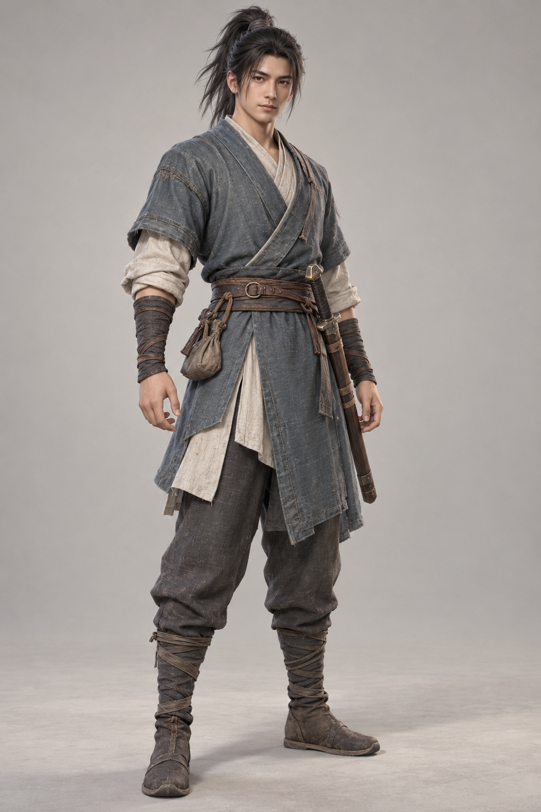

# AI概念美术

|文件|用途|
|---|---|
|[starter-village-wide-v1.png](starter-village-wide-v1.png)|新手村远景概念图|
|[player-novice-v1.png](player-novice-v1.png)|初入江湖玩家全身角色概念图|

相邻`*-prompt.md`保留原始生成提示词。使用内置AI图像生成工具生成，未混入外购素材。它们是设计参考，不是已完成的场景模型、角色模型、动画或实机截图；默认不导入客户端，避免把高分辨率展示图作为运行时资源。

本目录随仓库MIT许可提供，见根目录LICENSE；AI生成不构成对独占版权、商标或第三方权利的保证。未来引入的第三方美术、字体、音效必须单独核查并记录授权，不能自动改授MIT。

