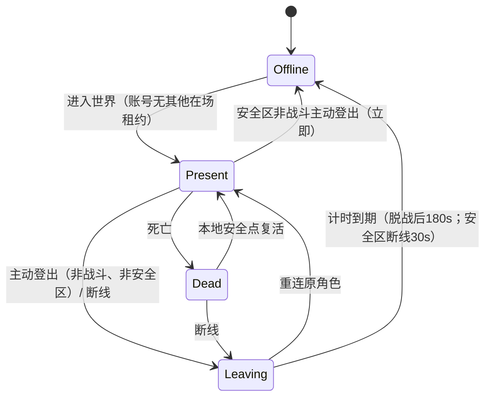
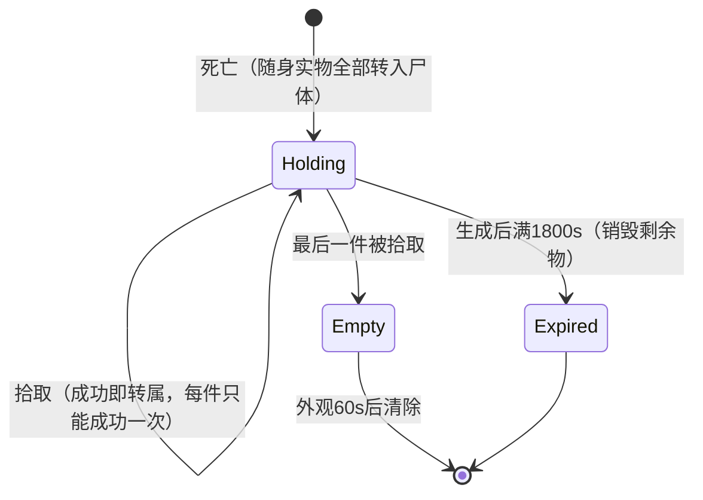
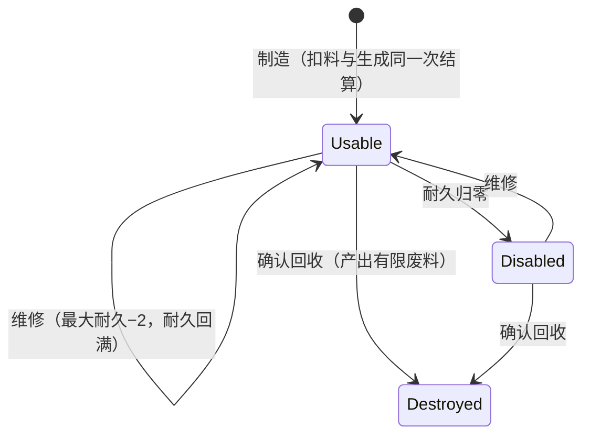
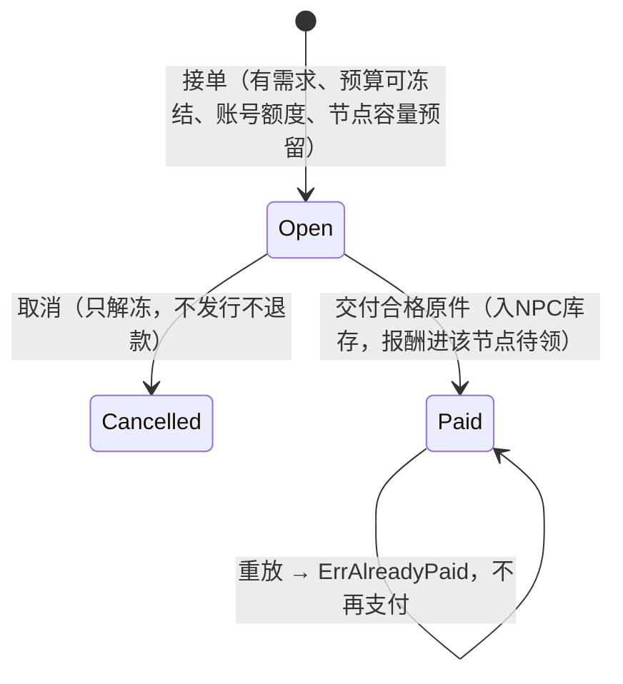
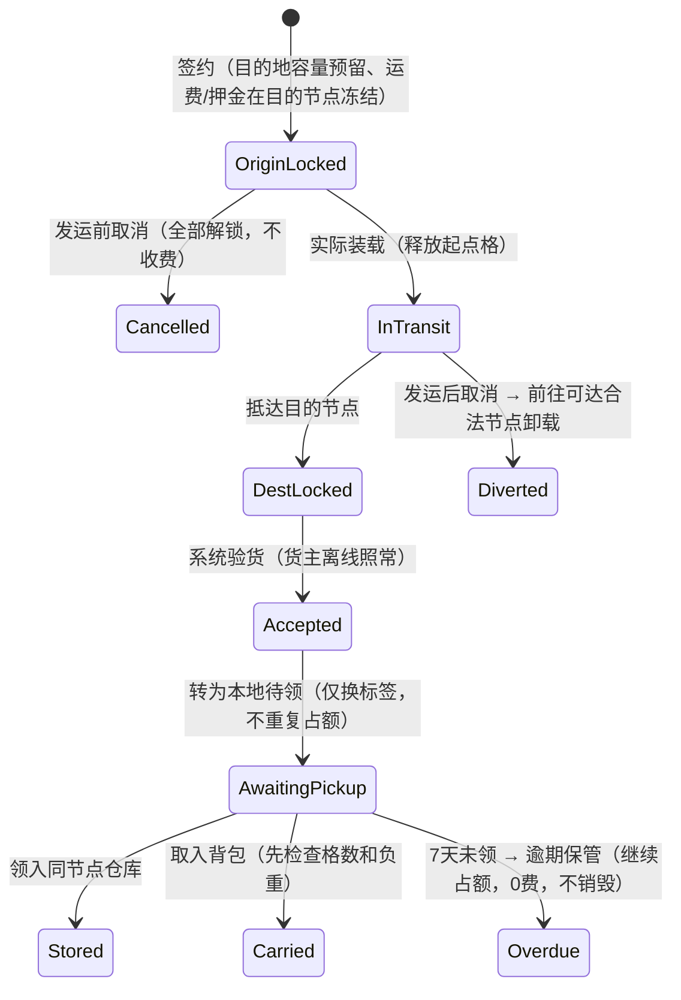
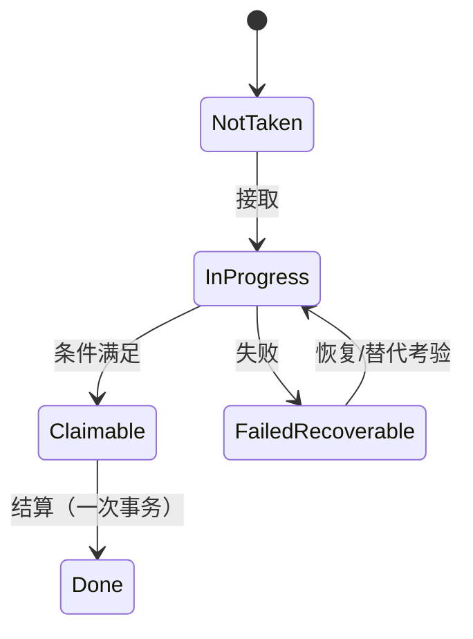

# 状态机（M0，测试参数）

本文件把设计文档中的状态规则整理成实现用状态机。依据：基线`完整设计执行基线_v0.44.md`（下称“基线”）§0.1、§1.2–§1.4、§2.1、§3.2，以及`equipment_ledger_v41.md`、`economy_v44.md`。

已在Go中实现并有测试的部分标“✅M0”；其余状态机由后续里程碑实现，实现时以本文为准，有改动须同步更新本文。

共同规则：每一次状态转移都是一次服务端事务，带`request_id`；同一请求重放时返回原结果，不重复执行（M1落库）。拒绝的转移不改变任何状态。

## 1. 角色在场租约（M2/M3）

- 同一账号全世界最多1个租约（`world.json characters.present_per_account`）。租约未结束时，**切角请求被拒绝**，只能重连原角色。
- 留在场内的角色不会自动作战；遭受的伤害和控制照常结算。
- 处于战斗状态时，进入安全区不会清除战斗；战斗优先于登出。计时：PVE 15s / PVP 30s脱战，有效伤害、控制、对战斗者治疗会刷新计时。
- 重连到已死亡的角色时，先进入死亡界面，不会再次掉落。

## 2. 尸体（M4）

- 计时从这次死亡生成尸体时开始；查看、打开、离线都**不刷新**计时。维护造成的停机区间顺延（基线§4.2）。
- 尸体与角色租约分开：角色离场、复活或切角都不会搬走尸体。

## 3. 装备实例 ✅M0（`internal/crafting`）

拒绝条件：材料不足、专业不符、最大耐久−2≤0、回收未确认、原件已不存在。被拒绝时库存和装备都保持原样。

## 4. NPC有限采购订单 ✅M0（`internal/economy`）

NPC实际消耗库存原件后，需求才重新开放。预算池按运行小时补充，冻结金额计入上限；维护期间不补发。

## 5. 物流合同与实物（M5）

- 部分货损时拆成可追溯的子批次，每个子批次单独走后续状态。
- 迟延时，每满1小时扣可变运费的5%，最多扣50%；系统故障或维护造成的迟延按影响区间顺延。
- 争议须在72小时内提交，只冻结争议金额。
- 节点可用格 = 200 − 实际占格 − 有效预留格；新承诺不能超额，但已有预留的到货必须照常转为交付。

## 6. 个人任务（M7）

- 任务物品若为实体，照常随身全掉。补办前先核对原件：已知原件仍存在时，要求取回或发替代考验；确需补发时，旧件先标记失效。补办不额外发稀有经济奖励。
- 必要进阶不能只靠唯一限时公共事件成功，也不能要求另一名真人在线。
